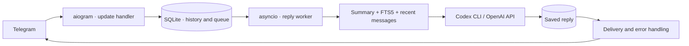

<div align="center">

# VibeCoder · Telegram Companion

A small, mysterious vibe coder with persistent memory, inside jokes, and mood-based stickers.


“Hehe… let's prompt those snacks into production 😼”

</div>

A Telegram companion for one group. It follows conversations, chooses when to reply, learns recurring expressions, and occasionally adds a sticker. Run it manually on your computer. The default generation backend uses an installed Codex CLI signed in with ChatGPT. An OpenAI API backend is also available.

The documentation, setup prompts, and management interface are in English. The default personality replies in Russian. Change the conversational language with an owner command such as `/style reply in English`.

## Features

- **Join the conversation naturally.** A 25% base reply chance, with direct mentions and replies bypassing random selection. Short messages and conversations explicitly addressed to other people receive fewer interruptions.
- **Follow a complete thought.** Adjacent messages from the same person are combined before generation. Telegram updates continue to be received while the model is working.
- **Remember across restarts.** SQLite stores the transcript, summaries, and pending jobs. FTS5 retrieves related older messages for the next response.
- **Pick up inside jokes.** Memory summaries preserve distinctive words, nicknames, and the context behind successful jokes. Participants can request changes to the conversational style.
- **Match stickers to the mood.** Received stickers become a reusable collection. Emoji provide initial tags, and the owner can adjust them. A suitable sticker accompanies approximately 30% of replies.
- **Keep prepared replies.** A persistent outbox survives restarts. Ambiguous delivery results are visible through `/outbox`.
- **Manage the bot from Telegram.** Owner commands control pauses, style, reply frequency, status, and memory deletion.

## Architecture



The default Codex model is **GPT-6-Luna** with `low` reasoning effort. Availability depends on your Codex account. Override it with `--model`. Replies and summary updates consume the selected provider's usage allowance. Longer memory increases the amount of context sent to the model.

## Quick start · Windows

Install Python 3.11+, Codex CLI, and create a Telegram bot through [@BotFather](https://t.me/BotFather).

```powershell
python -m venv .venv
.\.venv\Scripts\python.exe -m pip install -r requirements.txt
codex login
```

1. Create your bot with `/newbot` in BotFather.
2. Disable Privacy Mode with `/setprivacy`. Then remove and re-add the bot to the group, or make it a group administrator, so it can receive regular messages.
3. Run setup. When prompted, copy the token to your clipboard and press Enter in the terminal.

```powershell
.\.venv\Scripts\python.exe -X utf8 setup_bot.py
```

To discover the group ID, use the command below. Send `/chatid@your_bot_username` in the group when prompted. The ID appears in the terminal.

```powershell
.\.venv\Scripts\python.exe -X utf8 telegram_bot.py --find-chat
```

Run **`start-telegram-bot.cmd`**. It loads the saved bot token and group configuration. Stop it with Ctrl+C.

### Link the owner

On the first run, the terminal displays a one-time `/claim …` command. Send it **in a private chat with the bot** within 10 minutes. The sender's Telegram ID becomes the owner and is saved in the database. The code can only be used once. Restart the bot to get a new code if it expires.

You can also supply your numeric ID during setup with `setup_bot.py --owner-id YOUR_ID`. Use your own Telegram ID.

## Commands

| Command | Action |
| --- | --- |
| `/help` | Show the command reference |
| `/status` | Display mode, model, queue, memory, and error counts |
| `/pause` | Pause replies while continuing to receive and save messages |
| `/resume` | Resume replies |
| `/chance 25` | Set the base reply probability from 0 to 100% |
| `/style be calmer and more concise` | Save an explicit owner style preference |
| `/style reset` | Restore the initial vibe coder personality |
| `/tag laugh` | Reply to a sticker to assign a mood |
| `/outbox` | List saved replies with delivery errors |
| `/retry 12` | Manually retry outbox item 12 |
| `/forget` | Request deletion of the current topic's memory |

Management commands require the linked owner, except help and initial owner registration. Commands sent privately apply to the configured group. A private `/forget` applies to its main topic. To clear another topic, run the command inside that topic. Deletion requires a second command containing a one-time confirmation code. It removes that topic's transcript, summary, and outbox while retaining settings and the sticker collection.

Sticker tags are `laugh`, `shy`, `mystery`, `support`, `celebrate`, and `neutral`. Separate multiple tags with spaces. Imported sticker collections start with the `neutral` tag. Selection prefers a matching mood, then neutral stickers. A reply is sent as text when no suitable sticker exists. Russian tag aliases remain supported for existing chats.

Participants may request a different tone in ordinary conversation. An explicit owner `/style` setting has priority. Adaptation depends on the model and available context.

## Memory and usage

The database retains the full received text transcript and bot replies. Generation receives a summary of older conversation, up to 24 recent entries, and up to 4 retrieved historical messages. Summaries are updated in batches and may lose details. Retrieval uses word and prefix matching through SQLite FTS5.

Messages arriving during generation are saved immediately. Updates older than 3 minutes when received are retained in memory but do not trigger new replies. Telegram retains unprocessed updates for a limited period, so the bot cannot reconstruct an entire conversation after a long shutdown. Commands, other bots' messages, files without captions, and anonymous messages sent as the chat are excluded from conversational memory.

Default behavior

| Setting | Value |
| --- | --- |
| Codex model | `gpt-6-luna`, `low` reasoning |
| Base reply probability | 25% |
| Interval between reactions | At least 10 seconds |
| Message batching delay | 2 seconds |
| Adjacent fragment grouping | Same author and topic, within an 8-second window |
| Maximum text reply length | 1800 characters |
| Accompanying sticker | 30% probability when a suitable sticker exists |

## Delivery and recovery

Generated text is stored in the outbox before submission. On an explicit Telegram rate limit, the bot waits for the reported `retry_after` interval. Connection establishment failures use increasing delays, with up to 4 attempts.

A connection interrupted after submission, or a Telegram server error, can leave delivery unknown. Such replies receive the **`uncertain`** state. Check the chat, then use `/retry ID` if needed. Manual retries can create duplicates when the first submission succeeded. Exactly-once delivery is not guaranteed for ambiguous failures.

`telegram-bot.log` contains error categories and job states. Message text, model prompts, tokens, and owner-registration codes are excluded from the log. Logs rotate at 1 MB with up to three backups. Generation errors appear in `/status`, with categories in the log. Address the bot again to request a fresh reply after a generation error.

## Configuration and local files

`bot-config.example.json` shows the format for your local `bot-config.json`. Command-line arguments override group configuration. Supported environment variables include `TELEGRAM_CHAT_ID`, `TELEGRAM_OWNER_ID`, `TELEGRAM_BOT_TOKEN`, and `OPENAI_API_KEY`.

```powershell
.\.venv\Scripts\python.exe -X utf8 telegram_bot.py --model gpt-6-luna
.\.venv\Scripts\python.exe -X utf8 telegram_bot.py --mode mentions
```

Alternative OpenAI API backend

```powershell
.\.venv\Scripts\python.exe -X utf8 telegram_bot.py --backend api --model gpt-5.4-mini
```

When prompted, copy the API key and press Enter, or set `OPENAI_API_KEY` in the environment beforehand. This backend uses the API balance associated with that key's organization. Other API models may require compatible request parameters.

| Local file | Contents |
| --- | --- |
| `telegram-token.dpapi` | Bot token encrypted for the current Windows user |
| `bot-config.json` | Group ID and optional owner ID |
| `memory-*.sqlite3` | Transcript, summaries, search index, settings, stickers, and outbox |
| `stickers-*.json` | Automatically imported legacy sticker collection |
| `codex-cli-path.txt` | Optional local CLI executable path |
| `telegram-bot.log*` | Diagnostics |

Existing `messages` and `summaries` tables are preserved during upgrades. Additional tables and the search index are created automatically.

## Data and access

Tell group members that the bot stores message text and names and sends selected conversation context to OpenAI. The memory database contains readable conversation data on disk. Windows DPAPI protects the saved token for the current user account. Configure the token again when moving to a different computer.

Codex runs in read-only mode with shell, apps, plugins, and web search disabled. Telegram tokens and API keys are removed from its child-process environment. Conversational requests can change the persona; administrative actions use a separate Telegram-ID check.

`.gitignore` excludes tokens, local configuration, databases, stickers, logs, virtual environments, and temporary files. Review `git status` and the staged content before publishing.

## Development

```powershell
.\.venv\Scripts\python.exe -m unittest discover -s tests -v
```

Tests use temporary databases and mocked Telegram/model calls. They cover persistence, historical retrieval, fragment batching, owner authorization, durable delivery, sticker moods, pausing, and ambiguous send results. Russian-language fixtures exercise the bot's default conversation language. `.github/workflows/tests.yml` runs the suite on Windows with Python 3.11 and 3.14.

| File | Responsibility |
| --- | --- |
| `telegram_bot.py` | Entry point, Codex/API adapters, token encryption, and memory compatibility |
| `telegram_runtime.py` | aiogram transport, queue, FTS5, delivery, and commands |
| `setup_bot.py` | First-time configuration |
| `tests/test_runtime.py` | Behavior tests |

Released under the [MIT license](LICENSE).

Documentation: [aiogram](https://docs.aiogram.dev/), [Telegram Bot API](https://core.telegram.org/bots/api), [SQLite FTS5](https://www.sqlite.org/fts5.html), and [Codex CLI](https://developers.openai.com/codex/cli).
