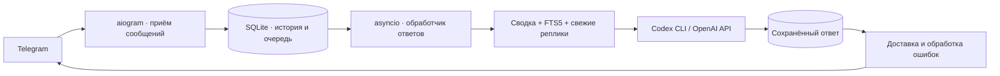

<div align="center">

# VibeCoder · Telegram Companion

Маленький загадочный вайбкодер с памятью, внутренними мемами и стикерами по настроению.


«Хихихи… сейчас напромптим хрумтики в прод 😼»

</div>

Бот живёт в одной Telegram-группе. Читает разговор, выбирает момент для ответа, запоминает словечки и иногда добавляет стикер. Запускается вручную на компьютере. Основной генератор — установленный Codex CLI с действующим входом через ChatGPT. Поддерживается и OpenAI API.

## Что умеет

- **Участвовать в разговоре.** Базовый шанс ответа 25%. На упоминание и ответ ему реагирует всегда с учётом паузы и доступности сервисов. Реже перебивает короткие реплики и явный диалог других участников.
- **Собирать мысль целиком.** Несколько соседних сообщений одного человека объединяются перед генерацией. Приём Telegram-сообщений продолжает работать во время ожидания модели.
- **Помнить после перезапуска.** SQLite хранит текстовую историю, сводки и очередь. Полнотекстовый поиск FTS5 возвращает связанные старые реплики в контекст.
- **Подхватывать мемы.** Сводка сохраняет характерные словечки, прозвища и контекст шуток. Манеру можно менять через чат.
- **Выбирать стикеры по настроению.** Бот запоминает присланные стикеры. Эмодзи дают начальный тег, владелец может уточнить теги командой. Стикер сопровождает примерно 30% ответов, если есть подходящий.
- **Сохранять готовые ответы.** Очередь исходящих сообщений переживает перезапуск. Неоднозначная доставка видна в `/outbox`.
- **Управляться из Telegram.** Пауза, стиль, частота, состояние и очистка памяти доступны владельцу.

## Как устроен



По умолчанию используется **GPT-6-Luna**, рассуждение `low`. Доступность зависит от твоего аккаунта Codex. Модель можно заменить параметром `--model`. Каждый ответ и обновление сводки расходуют лимиты выбранного провайдера. Более длинная память увеличивает объём входного контекста.

## Быстрый старт · Windows

Нужны Python 3.11+, установленный Codex CLI и Telegram-бот от [@BotFather](https://t.me/BotFather).

```powershell
python -m venv .venv
.\.venv\Scripts\python.exe -m pip install -r requirements.txt
codex login
```

1. Создай бота в BotFather через `/newbot`.
2. Выключи Privacy Mode через `/setprivacy`. Затем добавь бота в группу заново либо назначь его администратором, чтобы он получал обычные сообщения.
3. Выполни настройку. Скопируй токен, когда программа попросит, и нажми Enter в терминале.

```powershell
.\.venv\Scripts\python.exe -X utf8 setup_bot.py
```

ID группы можно узнать отдельным запуском. Он покажет ID в терминале после команды `/chatid@имя_бота` в группе.

```powershell
.\.venv\Scripts\python.exe -X utf8 telegram_bot.py --find-chat
```

Запусти **`start-telegram-bot.cmd`**. Токен и группа подставляются из сохранённой настройки. Остановить бота можно через Ctrl+C.

### Привязка владельца

При первом запуске терминал покажет одноразовую команду `/claim …`. Отправь её **в личные сообщения боту** в течение 10 минут. Telegram ID отправителя станет владельцем и сохранится в базе. Код повторно использовать нельзя. Если время истекло, перезапусти бота для нового кода.

Вместо привязки можно заранее указать свой числовой ID через `setup_bot.py --owner-id ТВОЙ_ID`. Не подставляй ID другого человека.

## Команды

| Команда | Действие |
| --- | --- |
| `/help` | Показать справку |
| `/status` | Режим, модель, очередь, память и число ошибок |
| `/pause` | Приостановить ответы, продолжая читать и сохранять чат |
| `/resume` | Продолжить отвечать |
| `/chance 25` | Базовый шанс ответа от 0 до 100% |
| `/style говори спокойно и короче` | Сохранить явную настройку владельца |
| `/style reset` | Вернуть начальную манеру вайбкодера |
| `/tag смех` | Ответом на стикер задать настроение |
| `/outbox` | Показать сохранённые ответы с ошибками доставки |
| `/retry 12` | Вручную повторить отправку ответа №12 |
| `/forget` | Запросить очистку памяти текущей темы |

Управляющие команды, кроме справки и первоначальной привязки, доступны владельцу. В личке команды относятся к настроенной группе, а `/forget` — к её основной теме. Для другой темы вызови `/forget` внутри неё. Очистка требует второй команды с одноразовым кодом. Она удаляет историю, сводку и исходящую очередь этой темы, сохраняя настройки и коллекцию стикеров.

Для `/tag` доступны `смех`, `смущение`, `загадочно`, `поддержка`, `радость`, `обычный`. Можно указать несколько тегов через пробел. Для старых коллекций начальный тег — `обычный`. Стикер выбирается среди подходящих настроению, затем среди нейтральных. Если подходящих нет, отправляется текст.

Участники могут просить сменить тон в обычном разговоре. Явная настройка владельца `/style` имеет приоритет. Результат адаптации зависит от модели и доступного контекста.

## Память и расход лимитов

В базе остаётся полный текст полученных сообщений и ответов. Для генерации передаются сводка старого разговора, до 24 свежих записей и до 4 найденных старых реплик. Сводка обновляется порциями и может терять детали. Поиск работает по словам и префиксам, без внешней векторной базы.

Сообщения, пришедшие во время генерации, сохраняются сразу. Обновления старше 3 минут при получении учитываются в памяти, но не вызывают новый ответ. Telegram хранит необработанные обновления ограниченное время, поэтому бот не восстанавливает всю переписку за долгий период выключения. Команды, сообщения других ботов, неподписанные файлы и анонимные сообщения от имени чата не входят в разговорную память.

Настройки по умолчанию:

| Параметр | Значение |
| --- | --- |
| Модель Codex | `gpt-6-luna`, рассуждение `low` |
| Базовая вероятность | 25% |
| Пауза между реакциями | минимум 10 секунд |
| Ожидание для объединения реплик | 2 секунды |
| Объединение соседних фрагментов | тот же автор и тема, окно до 8 секунд |
| Длина текстового ответа | до 1800 символов |
| Стикер к ответу | вероятность 30% при наличии подходящего |

## Доставка и сбои

Подготовленный текст записывается в исходящую очередь до отправки. При подтверждённом ограничении Telegram бот ждёт указанное `retry_after`. Ошибки установления соединения повторяются с увеличением паузы, максимум 4 попытки.

Если соединение оборвалось после отправки запроса или Telegram вернул серверную ошибку, результат доставки может быть неизвестен. Такой ответ получает состояние **`uncertain`**. Посмотри чат, затем при необходимости вызови `/retry ID`. Ручной повтор может создать дубль, если первая отправка дошла. Гарантия ровно одной доставки при подобных сбоях отсутствует.

Журнал `telegram-bot.log` содержит категории ошибок и состояния заданий. Тексты сообщений, запросы к модели, токены и одноразовый код привязки в журнал не записываются. Логи ротируются при достижении 1 МБ, сохраняется до трёх архивов. Ошибка генерации отмечается в `/status`, подробная категория есть в журнале. Для нового ответа после ошибки обратись к боту ещё раз.

## Настройки и данные

`bot-config.example.json` показывает формат локального `bot-config.json`. Параметры командной строки имеют приоритет над настройкой группы. Также поддерживаются `TELEGRAM_CHAT_ID`, `TELEGRAM_OWNER_ID`, `TELEGRAM_BOT_TOKEN` и `OPENAI_API_KEY`.

```powershell
.\.venv\Scripts\python.exe -X utf8 telegram_bot.py --model gpt-6-luna
.\.venv\Scripts\python.exe -X utf8 telegram_bot.py --mode mentions
```

Альтернативный генератор через OpenAI API:

```powershell
.\.venv\Scripts\python.exe -X utf8 telegram_bot.py --backend api --model gpt-5.4-mini
```

По подсказке скопируй API-ключ и нажми Enter, либо заранее задай OPENAI_API_KEY в окружении. Этот режим расходует API-баланс организации ключа. Для API с другой моделью может потребоваться изменить совместимые параметры запроса.

| Локальный файл | Содержимое |
| --- | --- |
| `telegram-token.dpapi` | Токен, зашифрованный Windows для текущего пользователя |
| `bot-config.json` | ID группы и необязательный ID владельца |
| `memory-*.sqlite3` | Переписка, сводки, поиск, настройки, стикеры и очередь |
| `stickers-*.json` | Коллекция из прежних версий, импортируется автоматически |
| `codex-cli-path.txt` | Необязательный локальный путь к CLI |
| `telegram-bot.log*` | Диагностика |

Существующие таблицы `messages` и `summaries` сохраняются при обновлении. Новые таблицы и поисковый индекс создаются автоматически.

## Работа с данными и доступом

Сообщи участникам группы, что бот хранит текст, имена и передаёт выбранный контекст OpenAI. База памяти содержит переписку в открытом виде на диске. Windows DPAPI защищает сохранённый токен с привязкой к учётной записи. Для переноса на другой компьютер выполни настройку токена заново.

Codex запускается с отключёнными shell, приложениями, плагинами и веб-поиском, в режиме read-only. Telegram-токен и API-ключи удаляются из окружения дочернего процесса. Разговорные просьбы могут менять манеру бота, административные операции проходят через отдельную проверку Telegram ID.

`.gitignore` исключает токены, конфигурацию, базы, стикеры, логи, окружение и временные файлы. Перед публикацией проверь `git status` и содержимое коммита.

## Разработка

```powershell
.\.venv\Scripts\python.exe -m unittest discover -s tests -v
```

Тесты используют временные базы и подменённые Telegram/модель. Они проверяют сохранение памяти, поиск, объединение сообщений, права владельца, очередь, настроение стикеров, паузу и обработку неоднозначной доставки. В `.github/workflows/tests.yml` подготовлен запуск тестов на Windows с Python 3.11 и 3.14.

| Файл | Назначение |
| --- | --- |
| `telegram_bot.py` | Точка входа, Codex/API, шифрование токена и совместимость памяти |
| `telegram_runtime.py` | aiogram, очередь, FTS5, доставка и команды |
| `setup_bot.py` | Первоначальная настройка |
| `tests/test_runtime.py` | Проверки поведения |

Проект распространяется под лицензией [MIT](LICENSE).

Документация используемых инструментов: [aiogram](https://docs.aiogram.dev/), [Telegram Bot API](https://core.telegram.org/bots/api), [SQLite FTS5](https://www.sqlite.org/fts5.html), [Codex CLI](https://developers.openai.com/codex/cli).
